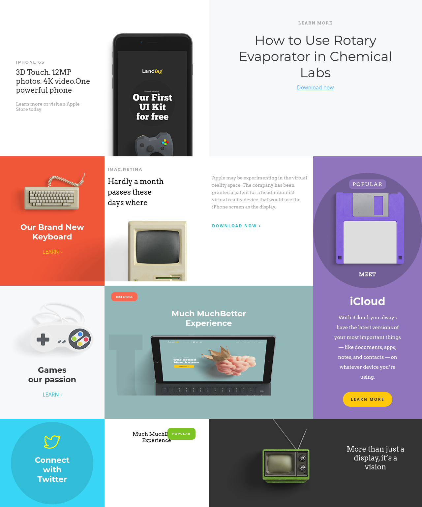
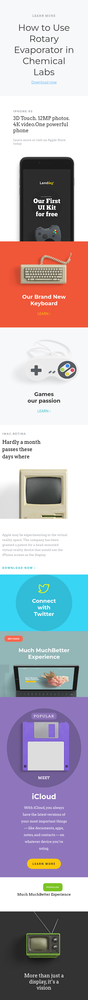

# Product Grid Landing

A responsive product-showcase landing page built entirely with CSS Grid - no
frameworks, no JavaScript. The layout rearranges itself across three breakpoints
using named grid areas.

**Live demo:** https://malakmo7amed309.github.io/css-grid-landing/

## Screenshots

| Desktop (4-column grid) | Mobile (stacked) |
| --- | --- |
|  |  |

## Features

- Asymmetric mosaic layout with `grid-template-areas`
- Three breakpoints: mobile-first stacked, 2-column tablet, 4-column desktop
- CSS custom properties for the color palette
- Google Fonts (Montserrat, Open Sans, Arvo)

## Tech stack

- HTML5
- CSS3 (Grid, custom properties, media queries)

## Run locally

Open `index.html` in a browser. No build step.

## Author

Malak Mohamed - [GitHub](https://github.com/malakmo7amed309)
